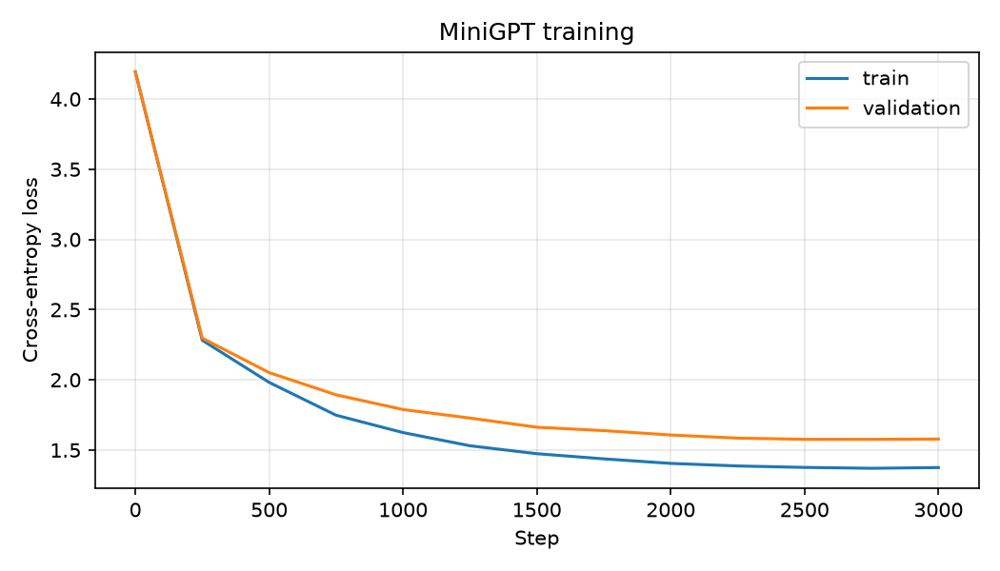

# MiniGPT

A small GPT-style language model implemented **from scratch in PyTorch**. It is trained at character level on a text corpus and can generate new text in the same style.

The goal of this project is to understand and demonstrate how transformer language models work internally, without relying on pre-built model libraries.

## Features

- Character-level tokenizer
- Causal multi-head self-attention
- Transformer blocks with residual connections, LayerNorm and a GELU feed-forward layer
- Learned token and positional embeddings
- Training loop with AdamW, cosine learning-rate decay and gradient clipping
- Train/validation loss tracking
- Text generation with temperature and top-k sampling
- Checkpoint saving and loading

## Project structure

```
.
├── main.py      # model, training and generation
├── plot_loss.py    # plots the training curve from loss_log.csv
├── loss_log.csv    # created during training
├── loss_curve.png  # created by plot_loss.py
└── README.md
```

## Installation

```bash
git clone <your-repo-url>
cd <your-repo-folder>
pip install torch matplotlib
```

## Usage

### Train

```bash
python main.py train --steps 3000
```

If no dataset is given, the script downloads the Tiny Shakespeare corpus automatically. To use your own text, pass a plain-text file:

```bash
python main.py train --data my_text.txt --steps 3000
```

Useful options:

| Option | Default | Description |
|---|---|---|
| `--steps` | 3000 | Number of training steps |
| `--batch_size` | 64 | Sequences per batch |
| `--block_size` | 128 | Context length in characters |
| `--n_embd` | 192 | Embedding size |
| `--n_head` | 6 | Attention heads |
| `--n_layer` | 6 | Transformer blocks |
| `--lr` | 3e-4 | Peak learning rate |

On a CPU-only machine, a smaller model trains faster:

```bash
python main.py train --n_layer 4 --n_embd 128 --steps 2000
```

### Generate text

```bash
python minigpt.py generate --prompt "ROMEO:" --tokens 400 --temperature 0.8 --top_k 40
```

- **temperature**: lower values give safer, more repetitive text; higher values give more varied (and more error-prone) text.
- **top_k**: only the k most likely next characters are considered at each step.

## Model configuration

| Setting | Value |
|---|---|
| Layers | 6 |
| Attention heads | 6 |
| Embedding size | 192 |
| Context length | 128 |
| Parameters | _fill in from the training output_ |
| Dataset | Tiny Shakespeare |

## Results

### Training curve



| Run | Layers | Embedding | Steps | Final train loss | Final val loss |
|---|---|---|---|---|---|
| Baseline | 6 | 192 | 3000 | _fill in_ | _fill in_ |

### Sample output

```
Paste a short sample generated by your trained model here.
```

## How it works

1. **Tokenization**: every distinct character in the training text becomes a token ID.
2. **Embeddings**: each token ID is mapped to a vector and combined with a learned position vector.
3. **Transformer blocks**: each block applies causal self-attention (every position can only look at earlier positions) followed by a small feed-forward network, with residual connections and LayerNorm.
4. **Output head**: a final linear layer converts the hidden state into scores for every character in the vocabulary.
5. **Training**: the model learns to predict the next character, optimised with cross-entropy loss.
6. **Generation**: the model repeatedly predicts a distribution over the next character, samples from it, appends the result to the input, and continues.

## Limitations

- This is a small educational model, not a production LLM. It works at character level, uses a tiny dataset and has only a few million parameters.
- Output imitates the style of the training data but has no real understanding or factual reliability.

## Possible improvements

- Byte-pair encoding (BPE) tokenizer
- Weight tying between the embedding and output layers
- Mixed-precision training
- A small web demo (for example with Gradio)
- Experiments comparing model depth, width and learning rate

## Acknowledgements

The architecture follows the design of GPT-2 and the educational approach popularised by Andrej Karpathy's nanoGPT and "Let's build GPT" lecture. The Tiny Shakespeare dataset comes from his `char-rnn` repository.
